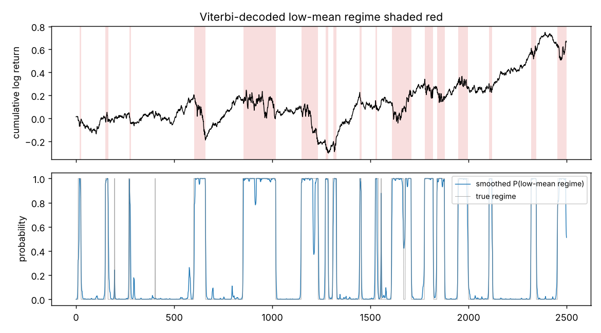

# gaussian-hmm-regime-detection

A Gaussian hidden Markov model for detecting market regimes (e.g. calm uptrend vs. volatile drawdown) in daily returns. Forward-backward, Viterbi and Baum-Welch (EM) are written from scratch in NumPy, all in log space. The implementation is checked against brute-force enumeration and against `hmmlearn`.

## In one paragraph

The market is modelled as switching between hidden regimes. Each regime has its own mean and volatility of daily returns, and a transition matrix gives the chance of staying in or leaving each regime from one day to the next. The three classic HMM algorithms each answer one question:
- **forward-backward:** how likely is each regime on each day?
- **Viterbi:** what is the single most likely sequence of regimes?
- **Baum-Welch (EM):** what parameters best explain the returns?

On 2,500 days of synthetic returns with known regimes, the fitted model labels **97.3%** of days correctly and recovers the volatilities and persistence closely. Using only past data, as a trader would have to, it still gets **94.4%**.

## Results (synthetic data with known regimes)

Data: 2,500 daily returns from a 2-state HMM. State 0 is "bear" (mean −0.15%/day, volatility 2.0%). State 1 is "bull" (mean +0.08%/day, volatility 0.8%). `make experiment`, `seed = 0`.

| | true | fitted |
|---|---|---|
| means μ | −0.00150, 0.00080 | −0.00149, 0.00099 |
| volatilities σ | 0.0200, 0.0080 | 0.0205, 0.0078 |
| stay probabilities A₀₀, A₁₁ | 0.970, 0.990 | 0.969, 0.987 |
| expected regime length (days) | 33, 100 | 33, 77 |

- **Regime decoding:** Viterbi labels 97.3% of days correctly. Smoothed posteriors (which use the whole series) get 97.3%. *Filtered* posteriors, which only use data up to day t and are the only ones a trading rule could use, get 94.4%. The gap between those last two is the price of not seeing the future.
- **Model selection:** BIC prefers K = 2 over K = 1 and K = 3 (−15,437 vs −14,631 and −15,388).
- **EM:** converged in 14 iterations. The log-likelihood never decreased, as EM guarantees (`artifacts/loglik.png`).
- **Means are the hardest parameters to pin down.** The bull-regime mean is estimated at 0.099% vs 0.080% true. A daily mean is tiny next to a daily volatility, so even 2,500 days pin it down only roughly. The volatilities and transition probabilities are recovered much more tightly, and they are what actually separates the regimes.

<p align="center"></p>

## Real data

`make spy` fits the same model to SPY daily log returns since 2005 via `yfinance` (`pip install -e ".[real-data]"`; needs internet). Real data has no ground truth, so the output is the fitted parameters, BIC by K and a regime plot (`artifacts/results_SPY.json`, `regimes_SPY.png`). That run isn't included here because the environment this version was built in had no market-data access.

## How it works

Model: s₁ ~ π, s_t | s_{t−1} ~ A[s_{t−1}, ·], y_t | s_t = k ~ N(μ_k, σ_k²).

**Forward-backward in log space.** A 2,500-step sequence has likelihood around e^7,746, and raw probability products overflow or underflow quickly. There are two standard fixes:
- rescale α and β at every step;
- keep everything as logs and combine terms with log-sum-exp.

This repo uses logs, because every intermediate quantity keeps a direct meaning (log α_t(k) = log p(y₁..t, s_t = k)), which makes it easy to test. The log-sum-exp over the previous state is computed as `c + log(exp(a − c) @ A)` with c = max(a), which is the same number but a matrix product, about 17× faster in Python than calling `logsumexp` per step.

**Baum-Welch.** The E-step computes γ_t(k) = P(s_t = k | y) and ξ_t(j,k) = P(s_t = j, s_{t+1} = k | y). The M-step has closed forms: A is normalized expected transition counts, and μ and σ are γ-weighted mean and standard deviation. Two practical details:
- EM only finds a local optimum, so `fit` runs 5 random restarts and keeps the best log-likelihood.
- Fitted states are relabelled by increasing mean, so "state 0" always means the low-mean regime. Without that, state labels are arbitrary (label switching) and results can't be compared across runs.

**Viterbi** is the max-product version of the forward pass with back-pointers. It returns the single most likely *path*. That is not the same as taking the most likely state at each day separately (smoothed argmax), though here they agree on almost all days.

**Filtered vs smoothed.** `smoothed_proba` uses all T observations, so using it for a trading backtest leaks the future. `filtered_proba` uses only y₁..t. A test checks that appending future data never changes past filtered probabilities.

## Tests

`make test` runs 8 tests:
- Likelihood, Viterbi path and smoothed posteriors match brute-force enumeration over all 2⁵ paths on a toy sequence.
- Log-likelihood matches `hmmlearn` to 1e-10 relative on a 3,000-step sequence.
- EM never decreases the likelihood.
- Fitting recovers the regimes (>95% Viterbi accuracy) and parameters.
- Filtered probabilities are causal.
- States are ordered by mean.

## How to run

```bash
pip install -e ".[dev]"     # or: make setup
make test
make experiment             # synthetic run -> artifacts/results.json, regimes.png, loglik.png
make spy                    # real SPY data (needs the real-data extra and internet)
```

## Limitations

- Univariate Gaussian emissions. Real returns have fat tails, which a Gaussian HMM partly absorbs by inventing extra high-volatility regimes; Student-t emissions would be the next step.
- Point estimates only: EM gives one parameter set and says nothing about how uncertain it is. [bayesian-regime-hmm](https://github.com/John-Ferd/bayesian-regime-hmm) fits the same model by Gibbs sampling to get posterior uncertainty.
- Regime durations in a time-homogeneous HMM are geometric, which real regimes need not be.
