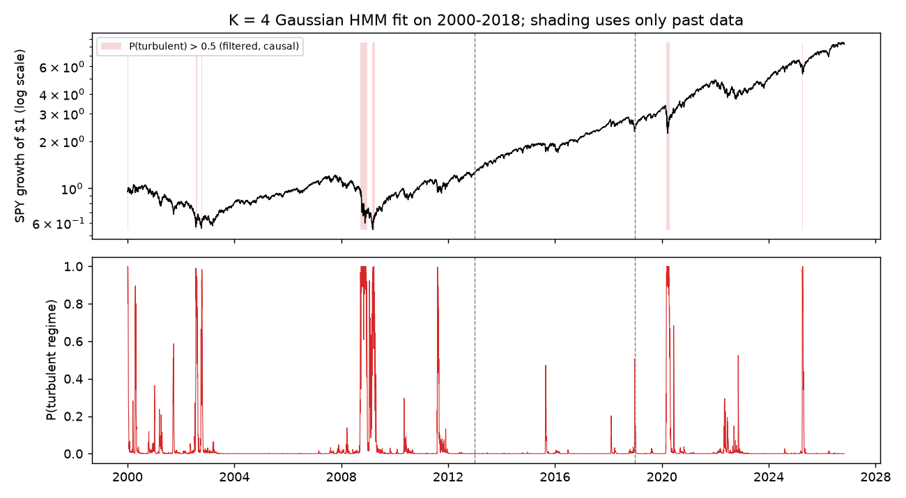
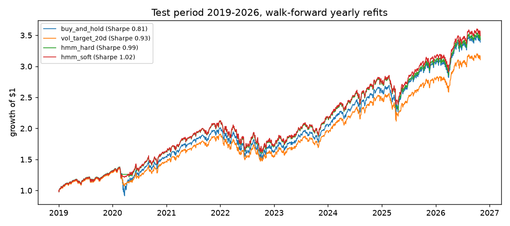
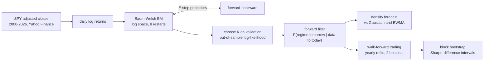

# gaussian-hmm-regime-detection

[](https://github.com/John-Ferd/gaussian-hmm-regime-detection/actions/workflows/ci.yml) 

A Gaussian hidden Markov model for detecting market regimes in **real SPY daily returns, 2000 to October 2026**. Forward-backward, Viterbi and Baum-Welch (EM) are written from scratch in NumPy, all in log space, and checked against brute-force enumeration and against `hmmlearn`. Every result below is out of sample: the model is fit on earlier years and scored on later ones it never saw.

> **Project history:** first built in 2025. In November 2026 it was rebuilt into a tested, reproducible package and published here, so the commit history starts then. All numbers in this README come from this published version.

## In one paragraph

The market is modelled as switching between hidden regimes, each with its own mean and volatility of daily returns, and a transition matrix gives the chance of staying in or leaving each regime from one day to the next. Fit to 2000-2018 and tested on 2019-2026, a **4-regime model** (chosen on a validation period, not the test period) gives better day-ahead return distributions than both a single Gaussian and the industry-standard RiskMetrics EWMA volatility model. Used for trading, stepping out of the market when the "crisis" regime is likely raised the test-period Sharpe ratio from **0.81 to 0.99** and cut the worst drawdown from **−34% to −25%**. The honest caveat: most of that gain comes from one event (March 2020), and a block bootstrap shows the Sharpe improvement is **not statistically significant**.

## Data and protocol

SPY daily log returns of adjusted closes (dividends and splits included), 6,747 trading days from Yahoo Finance. `make spy` downloads them once into `data/` and reuses the cached copy. The three periods are used strictly in order:

| period | years | days | used for |
|---|---|---|---|
| train | 2000-2012 | 3,268 | fitting (includes the dot-com bust and 2008) |
| validation | 2013-2018 | 1,510 | choosing the number of regimes K and the trading rule |
| test | 2019-Oct 2026 | 1,969 | reported once; nothing is chosen on it |

Every forecast is **causal**: the regime probabilities used on day t+1 come from the forward filter run over data up to day t.

## Results

### 1. Which model forecasts tomorrow's return distribution best?

Score: the out-of-sample log-likelihood of each day's return under the density forecast made the day before (higher is better). Validation picks K; the chosen model is then refit on train + validation and scored on the test period.

| model | validation log-lik (fit on train) | test log-lik (fit on train + validation) |
|---|---|---|
| single Gaussian (K = 1) | 4,834 | 5,898 |
| HMM, K = 2 | 5,233 | 6,299 |
| HMM, K = 3 | 5,332 | 6,382 |
| **HMM, K = 4** (chosen on validation) | **5,339** | **6,416** |
| RiskMetrics EWMA volatility (λ = 0.94) | n/a | 6,294 |

- K = 4 was chosen on validation, and BIC on the training data agrees (−20,244 vs −20,228 for K = 3).
- On the test period the K = 4 HMM beats a single Gaussian by **0.26 nats per day** and EWMA volatility, a strong and widely used baseline, by **0.06 nats per day**.
- EWMA only adapts the volatility. The HMM also knows that turbulent periods have fatter tails and tend to persist, so it gives extreme days more probability.

**The four regimes** (fit on 2000-2018, ordered calm to turbulent):

| regime | mean daily return | annual volatility | average length | share of days |
|---|---|---|---|---|
| calm | +0.116% | 7.6% | 24 days | 39% |
| normal | +0.015% | 14.9% | 18 days | 32% |
| stressed | −0.079% | 24.5% | 41 days | 26% |
| crisis | −0.263% | 56.4% | 21 days | 3% |

<p align="center"></p>

The crisis regime lights up in 2002, late 2008, August 2011, March 2020 and April 2025. The shading uses filtered probabilities (each day's value depends only on returns up to that day), but the model's parameters are fit on 2000-2018. So the shading before 2019 is in-sample, and only 2019 onward is genuinely out of sample. The trading results below avoid this by refitting every year on earlier data only. *(The title on the chart image predates this correction; it updates on the next `make spy` run.)*

### 2. Does trading on the regime help? (walk-forward, test period 2019-2026)

Every calendar year, the HMM is refit on all data before that year and then trades the year using only the forecast made at each previous close. There is a 2 bp cost per unit of turnover.

| strategy | Sharpe | annual return | annual vol | max drawdown | avg exposure |
|---|---|---|---|---|---|
| buy and hold | 0.81 | 16.9% | 19.2% | −33.7% | 1.00 |
| volatility targeting (20-day, 21.6% target) | 0.93 | 15.6% | 15.6% | −22.9% | 0.96 |
| **HMM hard switch** (chosen on validation) | **0.99** | **17.1%** | 15.9% | −24.5% | 0.98 |
| HMM soft (exposure = 1 − P(crisis)) | 1.02 | 17.4% | 15.6% | −23.9% | 0.97 |

<p align="center"></p>

- The rule was chosen on validation (2013-2018), where neither HMM rule beat buy-and-hold: there was almost no crisis to avoid. The hard switch was picked because its validation Sharpe was slightly higher than the soft rule's (0.87 vs 0.86). On the test period the soft rule happened to do a little better, but it was not chosen, and reporting it as the headline would be picking with hindsight.
- **Statistical significance.** A stationary block bootstrap (20-day blocks, 2,000 resamples) gives a 95% interval for the Sharpe gain of **[−0.16, +0.58]** against buy-and-hold and **[−0.12, +0.31]** against volatility targeting. Both include zero. Seven years with essentially one crash in them is not enough to prove an edge.
- **Where the gain comes from:** almost entirely from being out of the market for part of March 2020. The rule is in the market 98% of the time and trades about once a year.
- Volatility targeting is included because it is the simple benchmark any "step aside in turbulence" rule should beat. The HMM rule beats it on this test period, but not significantly.

## Architecture



## How it works

Model: s₁ ~ π, s_t | s_{t−1} ~ A[s_{t−1}, ·], y_t | s_t = k ~ N(μ_k, σ_k²).

**Forward-backward in log space.** A 6,700-day sequence has a likelihood around e^20,000, and raw probability products overflow or underflow quickly. There are two standard fixes:
- rescale α and β at every step;
- keep everything as logs and combine terms with log-sum-exp.

This repo uses logs, because every intermediate quantity keeps a direct meaning (log α_t(k) = log p(y₁..t, s_t = k)), which makes it easy to test. The log-sum-exp over the previous state is computed as `c + log(exp(a − c) @ A)` with c = max(a), which is the same number but a matrix product, about 17× faster in Python than calling `logsumexp` per step.

**Baum-Welch.** The E-step computes γ_t(k) = P(s_t = k | y) and ξ_t(j,k) = P(s_t = j, s_{t+1} = k | y). The M-step has closed forms: A is normalized expected transition counts, and μ and σ are γ-weighted mean and standard deviation. EM only finds a local optimum, so `fit` runs several random restarts and keeps the best log-likelihood. States are relabelled by increasing mean so results are comparable across runs.

**One-step-ahead forecasts.** Because log p(y₁..t) = logsumexp_k log α_t(k), the predictive log density of day t given the past is the difference of two consecutive cumulative values (`one_step_logpdf`). Summed over a held-out period, that is the out-of-sample log-likelihood used to choose K. Tomorrow's regime distribution is the filtered distribution times the transition matrix (`predict_next_proba`).

**Filtered vs smoothed.** `smoothed_proba` uses all T observations, so using it in a backtest would leak the future. Everything that trades or forecasts uses the filter, and tests check that appending future data never changes past forecasts.

**Viterbi** is the max-product version of the forward pass with back-pointers. It returns the single most likely regime *path*, used for the "share of days" column above.

## Tests

`make test` runs 15 tests, on small simulated sequences where the true regimes are known (that is the only way to check correctness exactly). The experiments themselves use only real data.
- Likelihood, Viterbi path and smoothed posteriors match brute-force enumeration over all 2⁵ paths on a toy sequence.
- Log-likelihood matches `hmmlearn` to 1e-10 relative on a 3,000-step sequence.
- EM never decreases the likelihood; fitting recovers known regimes and parameters; states are ordered by mean.
- One-step predictive log densities sum exactly to the total log-likelihood.
- Filtered probabilities, regime forecasts and volatility-targeting positions are causal.
- The backtest holds yesterday's position, charges costs per unit of turnover, and computes drawdowns correctly.
- The bootstrap interval contains its point estimate.

## How to run

```bash
pip install -e ".[dev]"     # or: make setup
make test
make spy                    # downloads SPY once (needs internet), ~4 minutes on a multi-core machine
                            # -> artifacts/results_SPY.json, regimes_SPY.png, backtest_SPY.png, loglik_SPY.png
```

Adjusted prices are rescaled by a constant whenever a new dividend is paid, which leaves log returns, and so every number here, unchanged between downloads.

## Limitations

- Univariate Gaussian emissions. Real returns have fat tails even within a regime; part of what the 4-state model does is approximate a fat-tailed distribution with extra high-volatility states. Student-t emissions would be the next step.
- One asset, one test period. The trading result rests on 7 years containing essentially one crash, which is why it is not significant.
- Parameters are frozen for a year between refits; regime durations in a time-homogeneous HMM are geometric, which real regimes need not be.
- Point estimates only: EM gives one parameter set. [bayesian-regime-hmm](https://github.com/John-Ferd/bayesian-regime-hmm) fits regime models by Gibbs sampling to carry parameter uncertainty into the forecast.
